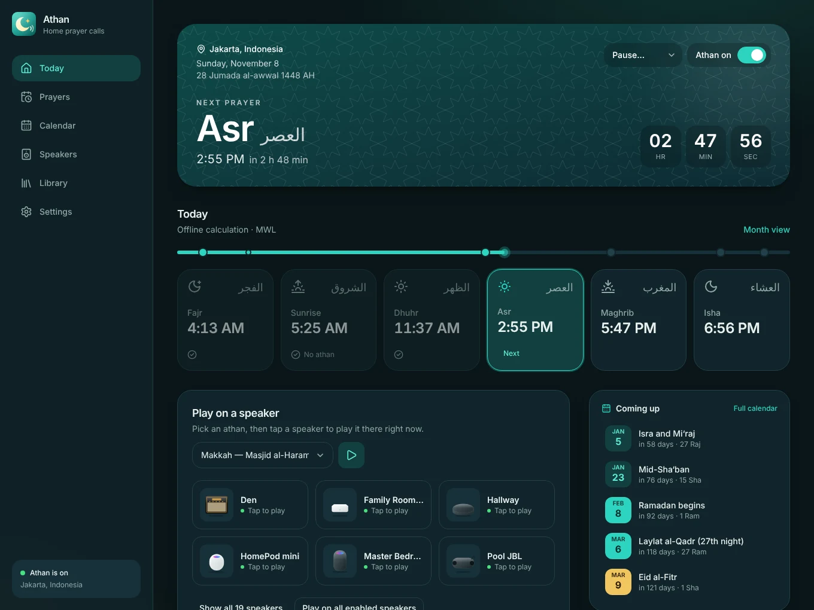
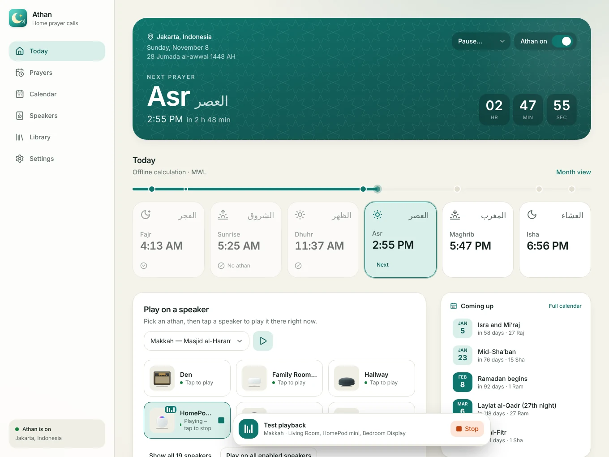
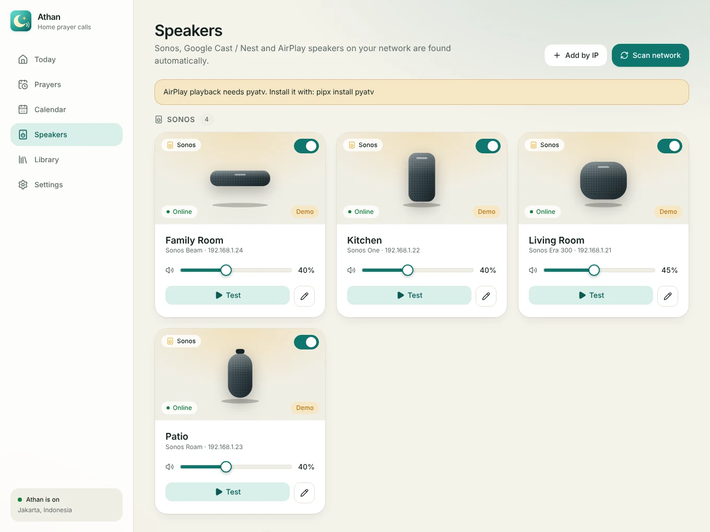
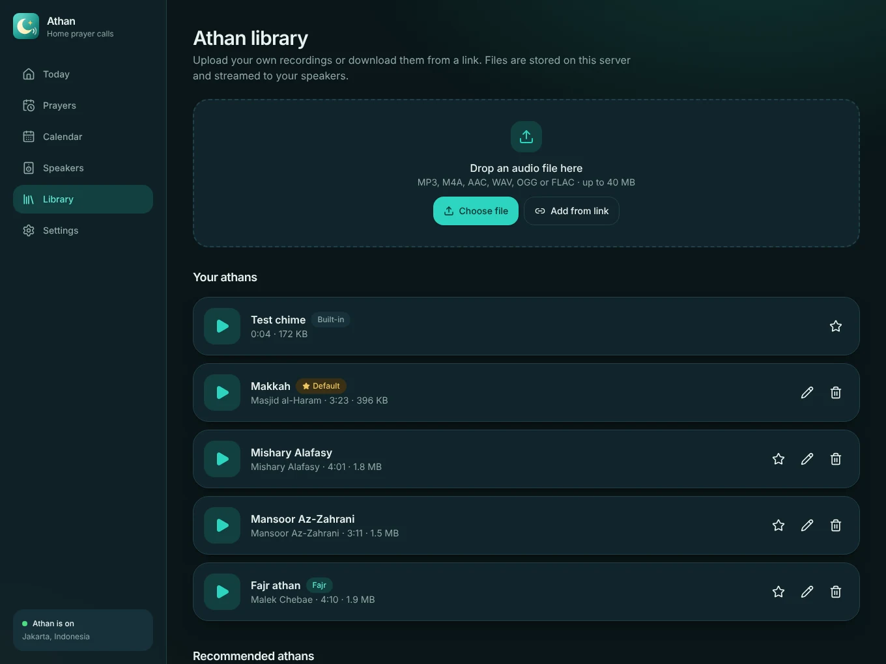
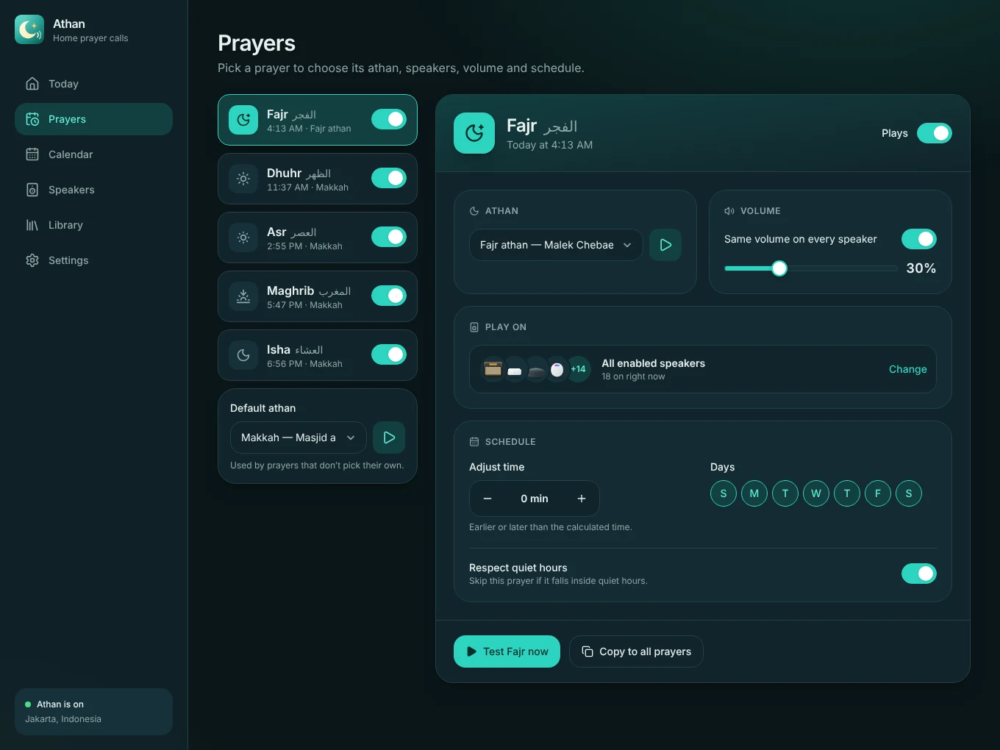
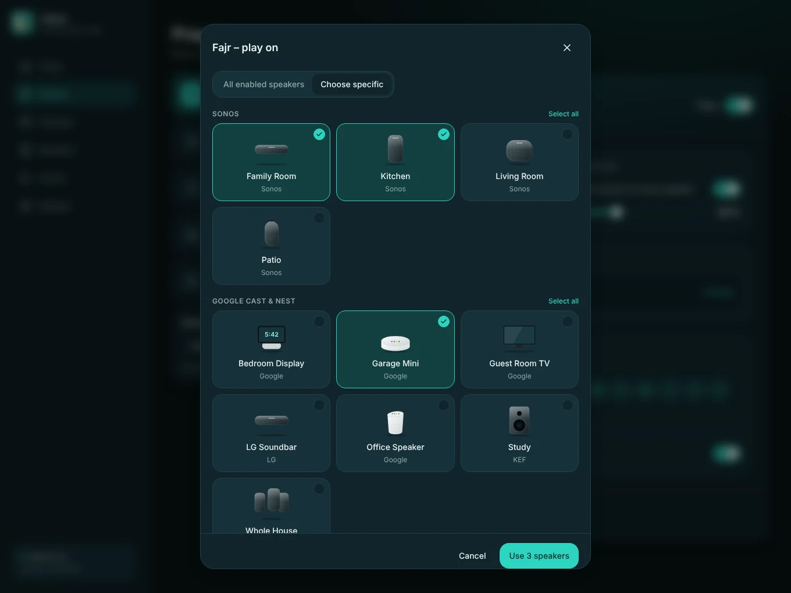
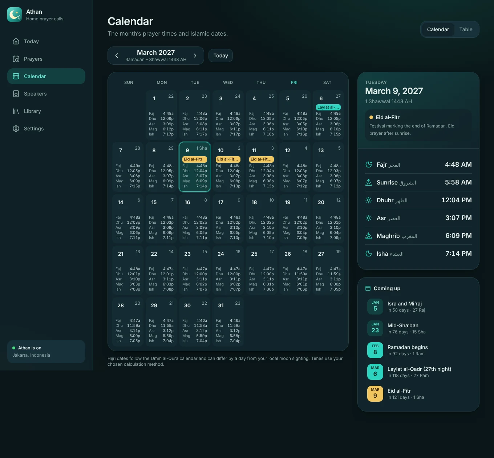
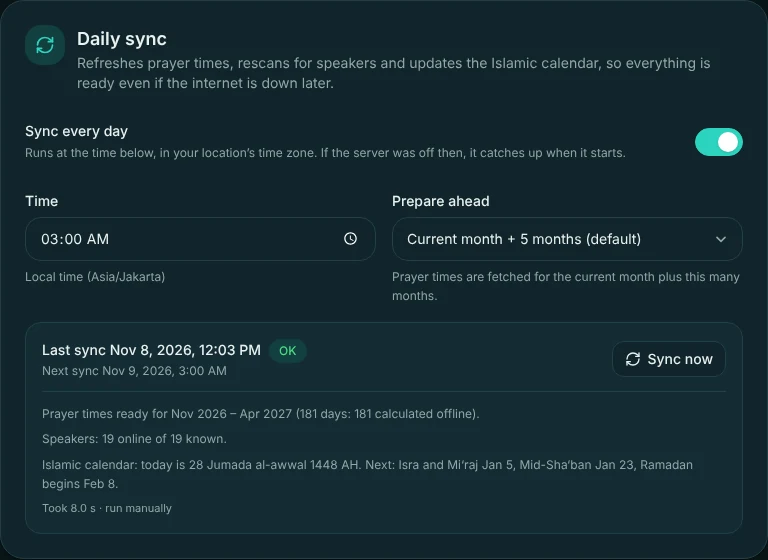
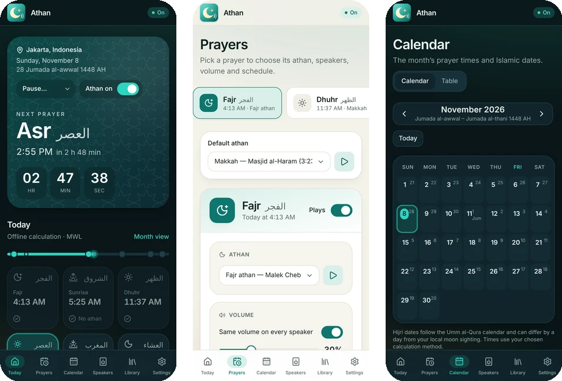

<div align="center">


# Athan Server

**Play the call to prayer on your home speakers, automatically.**
A self-hosted server for any always-on computer: Raspberry Pi, PC, Mac, NAS or home server.

[](https://github.com/naveedhuq/athan-local-server/actions/workflows/ci.yml)
[](https://github.com/naveedhuq/athan-local-server/actions/workflows/docker.yml)
[](LICENSE)



<sub>Screenshots use simulated demo speakers.</sub>

</div>

---

## Contents
- [Features](#features)
- [Quick start](#quick-start)
- [Installation](#installation) – [Docker](#docker-linux-nas-raspberry-pi) · [Windows, macOS, Linux](#without-docker-windows-macos-linux) · [Raspberry Pi / Debian](#raspberry-pi--debian--ubuntu-from-source) · [Docker Desktop](#docker-desktop-macos--windows)
- [Configuration](#configuration) – [Environment variables](#environment-variables) · [Settings reference](#settings-reference) · [Data and backups](#where-your-data-lives)
- [User guide](#user-guide)
- [Integrations](#integrations-home-assistant-mqtt-webhooks)
- [How it works](#how-it-works)
- [Troubleshooting](#troubleshooting)
- [Privacy and network use](#privacy-and-network-use)
- [Development and releases](#development-and-releases)
- [License and credits](#license-and-credits)

## Features

| | |
|---|---|
| **Plays on your speakers** | Finds **Sonos**, **Google Cast / Nest** and **AirPlay** speakers on your network automatically, or add one by IP. Play on one speaker, several, or all of them, each with its own volume. Sonos and Cast go back to what they were playing afterwards. Can also use the computer's own speakers. |
| **Accurate prayer times** | [Aladhan](https://aladhan.com/prayer-times-api) with 16 calculation methods, cached; automatic fallback to built-in offline calculation. Hanafi/standard Asr, high-latitude rules, per-prayer minute offsets, or fixed times from your mosque's timetable. |
| **Per-prayer control** | Skip any prayer (for example Fajr), pick a different athan, speakers, volume and weekdays for each one. "Copy to all prayers" in one click. |
| **Athan library** | Upload your own recordings, add from a link, or pick from recommended athans. Preview in the browser. |
| **Calendar** | A month grid and table of prayer times with Hijri dates and Islamic events (Ramadan, both Eids, Ashura, Laylat al-Qadr and more), plus a Hijri date adjustment for local moon sighting. |
| **Daily sync** | Every night (3:00 AM by default) it refreshes prayer times for the current month plus the next 5 months, rescans for speakers and updates the Islamic calendar. |
| **Quiet hours and pause** | Skip athans overnight, pause for an hour or three days, or switch everything off. |
| **Home automation** | MQTT with Home Assistant auto-discovery, and webhooks (ntfy, Gotify and similar). |
| **Modern, responsive UI** | Works on phones, tablets and desktops, light and dark, and installs to the home screen like an app. |

## Quick start

Pick the option that fits your computer, then open **`http://<that-computer>:8080`** from any phone or laptop on your home network.

| You have | Run |
|---|---|
| Linux server, NAS or Raspberry Pi with Docker | `git clone https://github.com/naveedhuq/athan-local-server.git && cd athan-local-server && docker compose up -d` |
| Windows, macOS or Linux without Docker | Install [Node.js 20+](https://nodejs.org), download the release bundle, run `node athan.mjs` ([details](#without-docker-windows-macos-linux)) |
| Raspberry Pi / Debian / Ubuntu, from source | `sudo ./deploy/install.sh` ([details](#raspberry-pi--debian--ubuntu-from-source)) |

Then follow the [first-run steps](#1-first-run-set-your-location).

## Installation

### Before you start: networking

Speakers are found with multicast (mDNS for Google Cast and AirPlay, SSDP for Sonos), and **they download the athan audio from this server**. So:

- The server and the speakers must be on the **same network / VLAN**, and the router must not block multicast between Wi-Fi and Ethernet ("client isolation", "AP isolation").
- Allow **inbound TCP 8080** (the web UI and the audio files) in the server's firewall for your home network.
- If discovery can't work (VLANs, Docker bridge networking), use **Speakers → Add by IP**. That works for Sonos, Cast and AirPlay.
- If the server advertises the wrong address to speakers (several network cards, VPN, Docker), set the **Public address override** in *Settings → System*, or the `PUBLIC_URL` environment variable, to something like `http://192.168.1.20:8080`.

> **There is no login.** Anyone on your network can open the UI. Only run it on a network you trust, and don't expose port 8080 to the internet.

| Port / protocol | Direction | Used for |
|---|---|---|
| TCP 8080 | speakers → server | Web UI and athan audio files |
| UDP 1900 (SSDP), TCP 1400 | server → Sonos | Sonos discovery and control |
| UDP 5353 (mDNS), TCP 8009 | server → Cast / AirPlay | Cast and AirPlay discovery; Cast control |

### Docker (Linux, NAS, Raspberry Pi)

Images for **amd64 and arm64** (PCs, Macs, NAS boxes, Raspberry Pi) are published to `ghcr.io/naveedhuq/athan-local-server`.

```bash
git clone https://github.com/naveedhuq/athan-local-server.git
cd athan-local-server
docker compose up -d
```

Open `http://<server-ip>:8080`. Your settings and athan files live in the `athan-data` Docker volume.

| Task | Command |
|---|---|
| Logs | `docker compose logs -f` |
| Update | `docker compose pull && docker compose up -d` |
| Stop | `docker compose down` (add `-v` to also delete your data) |
| Set the time zone | `TZ=America/New_York docker compose up -d` |
| Build locally instead of pulling | `docker compose up -d --build` |
| Plain `docker run` | `docker run -d --name athan --network host -v athan-data:/data --restart unless-stopped ghcr.io/naveedhuq/athan-local-server:latest` |
| Play through the server's own speakers | `docker compose build --build-arg WITH_LOCAL_AUDIO=1`, then uncomment the `devices` and `group_add` lines in `docker-compose.yml` |

**Host networking is required** (the compose file sets it), because speaker discovery uses multicast, which doesn't cross Docker's normal bridge network.

#### Docker Desktop (macOS / Windows)

Docker Desktop runs containers inside a virtual machine, so multicast discovery can't work. It still runs fine if you add speakers by IP:

```bash
# macOS / Linux
PUBLIC_URL=http://192.168.1.20:8080 docker compose -f docker-compose.bridge.yml up -d
```
```powershell
# Windows PowerShell
$env:PUBLIC_URL="http://192.168.1.20:8080"
docker compose -f docker-compose.bridge.yml up -d
```

Use your computer's own LAN address for `PUBLIC_URL` (find it with `ipconfig` on Windows or `ipconfig getifaddr en0` on a Mac), then use **Speakers → Add by IP**. For a hassle-free setup on a Mac or PC, the native install below is better.

### Without Docker (Windows, macOS, Linux)

You need **Node.js 20 or newer**: [nodejs.org](https://nodejs.org), `brew install node`, or `winget install OpenJS.NodeJS.LTS`.

1. Download `athan-server-<version>.zip` (or `.tar.gz`) from the repository's **Releases** page and extract it anywhere.
2. Start it:
   - macOS / Linux: `./start.sh`
   - Windows: double-click `start.cmd`
   - Anywhere: `node athan.mjs`
3. Open `http://localhost:8080`.

The same bundle runs on every OS because it only uses pure-JavaScript dependencies.

#### Start automatically

Run the matching script from the extracted folder:

| OS | Install | Uninstall |
|---|---|---|
| Linux (systemd) | `sudo ./service/install-linux.sh` | `sudo ./service/install-linux.sh --uninstall` |
| macOS (launchd, at login) | `./service/install-macos.sh` | `./service/install-macos.sh --uninstall` |
| Windows (at login) | `.\service\install-windows.ps1` in PowerShell (run once as Administrator to also open the firewall) | `.\service\install-windows.ps1 -Uninstall` |

macOS may ask to let Node find devices on your local network: choose **Allow**. Windows may show a firewall prompt: allow it on **Private** networks.

**Upgrade:** stop the server, extract the new release into a fresh folder, start it. Your data lives elsewhere (see [Where your data lives](#where-your-data-lives)), so nothing is lost.

#### Optional extras

| For | Install |
|---|---|
| AirPlay speakers | [pyatv](https://pyatv.dev): `pipx install pyatv` |
| Playing through this computer's own speakers | `mpv` (`apt install mpv` · `brew install mpv` · `winget install mpv`). macOS also has the built-in `afplay`. |

### Raspberry Pi / Debian / Ubuntu, from source

```bash
git clone https://github.com/naveedhuq/athan-local-server.git
cd athan-local-server
sudo ./deploy/install.sh
```

This installs Node 22, mpv and pyatv, builds the app, and sets up a systemd service. Check it with `systemctl status athan` and read logs with `journalctl -u athan -f`.

## Configuration

### Environment variables

| Variable | Default | Meaning |
|---|---|---|
| `PORT` | `8080` | Port for the web UI and athan audio |
| `HOST` | `0.0.0.0` | Network interface to listen on |
| `DATA_DIR` | per-OS folder ([see below](#where-your-data-lives)); `/data` in Docker | Where settings and athan files are stored |
| `PUBLIC_URL` | auto-detected LAN address | Address speakers use to fetch audio, e.g. `http://192.168.1.20:8080`. Needed in Docker bridge mode. |
| `LOG_LEVEL` | `info` | `debug`, `info`, `warn` or `error` |
| `TZ` | host setting | Time zone for log timestamps (prayer times always use your location's zone) |
| `ATHAN_MOCK` | off | `1` adds simulated speakers for demos and development |

### Settings reference

Everything else is configured in the web UI.

| Where | Setting | What it does |
|---|---|---|
| **Settings → Location** | Search, detect or coordinates | Prayer times depend on it. The time zone is worked out from the coordinates. |
| **Settings → Prayer time calculation** | Method | Choose the authority your mosque or community follows (ISNA, Muslim World League, Umm al-Qura, Egyptian, Karachi, Diyanet and more). |
| | Asr (madhab) | Standard (Shafi'i, Maliki, Hanbali) or Hanafi. |
| | High-latitude rule | Only matters far north or south, where twilight lasts all night in summer. |
| | Online / offline | Online uses Aladhan (cached); offline is a built-in calculation. If online fails, offline is used automatically. |
| | Fixed times | Replace any calculated time with your mosque's timetable. |
| **Settings → Islamic calendar** | Hijri date adjustment | Shift Hijri dates by −2 to +2 days to match local moon sighting. |
| **Settings → Daily sync** | Time, months ahead | When to sync (default 03:00) and how many months of prayer times to prepare (current month plus 5 by default). |
| **Settings → Quiet hours** | From / until | Athans inside this window are skipped (each prayer can opt out). |
| **Settings → Integrations** | MQTT, webhook | See [Integrations](#integrations-home-assistant-mqtt-webhooks). |
| **Settings → Appearance** | Theme, 12/24-hour clock | Saved in your browser only. |
| **Settings → System** | Public address override | Same as `PUBLIC_URL`. |
| **Prayers** | Per prayer | On/off, athan, speakers, volume, minute offset, weekdays, quiet-hours behaviour. |
| **Speakers** | Per speaker | On/off, athan volume, display name, picture. |
| **Library** | Default athan | Used by prayers that don't pick their own. |

### Where your data lives

Settings and athan files are stored **outside** the program, so upgrades never touch them.

| How you run it | Data folder |
|---|---|
| Docker | the `athan-data` volume (`/data` in the container) |
| Windows | `%APPDATA%\Athan` |
| macOS | `~/Library/Application Support/Athan` |
| Linux (bundle) | `~/.local/share/athan` |
| Raspberry Pi installer | `/var/lib/athan` |
| From source (development) | `./data` |

| File | Contents |
|---|---|
| `config.json` | All your settings |
| `athans/` | Your athan audio files and their index |
| `speakers.json` | Speakers seen on your network |
| `sync.json` | Result of the last daily sync |
| `cache/times.json` | Cached prayer times |

**Backup:** copy the data folder while the server is stopped (or just `config.json` and `athans/`). **Restore:** put it back and start the server. In Docker: `docker run --rm -v athan-data:/data -v "$PWD":/backup alpine tar czf /backup/athan-backup.tgz -C /data .`

## User guide

### 1. First run: set your location

Open the web UI. On a fresh install you are asked where you are. **Search** for your city, **detect** it from your internet connection, use your **device location**, or enter **coordinates**. (Browsers only share device location on `https://` or `localhost`.) You can change it later in *Settings → Location*.

### 2. The home screen



- **Banner:** the next prayer with a countdown, your location, and today's date in both calendars. The **Athan on/off** switch and **Pause** menu (1 hour to 3 days) are here too. If a day has an Islamic event, a gold chip shows it.
- **Today:** a timeline of the day and a card for each time. The next prayer is highlighted, and prayers you've turned off say *Skipped*.
- **Play on a speaker:** choose an athan, then tap any speaker to play it right now. Tap it again to stop. *Play on all enabled speakers* plays everywhere. A bar at the bottom shows what's playing, with a **Stop** button, on every page.
- **Coming up:** the next Islamic events with countdowns. In Ramadan, suhoor and iftar times appear above it.
- **Recent activity:** what the server played, skipped or failed to do.

### 3. Speakers



Speakers appear automatically as they're found, grouped by Sonos, Google Cast and AirPlay. For each speaker you can:

- **Switch it on or off** for the athan.
- Set its **athan volume** (used unless a prayer overrides it).
- **Test** it with any athan.
- **Rename it or change its picture** (the pencil icon). The picture is chosen automatically from the model name; pick a different one if it looks wrong.

If a speaker doesn't show up, use **Add by IP**. Sonos players that are grouped play together, so ungroup them in the Sonos app if you want separate rooms.

### 4. Athan library



- **Upload** an MP3, M4A, AAC, WAV, OGG or FLAC file (up to 40 MB), or **add from a link** to a direct audio file. The server keeps its own copy.
- **Recommended athans:** one tap downloads a ready-made athan (including one for Fajr) to the server.
- Press play to **preview** in your browser; the star makes an athan the **default**; the pencil edits its name and muezzin.

Athan recordings are often copyrighted, and none are bundled. The recommended list comes from [abodehq/Athan-MP3](https://github.com/abodehq/Athan-MP3), which doesn't publish a license, so use those for personal listening at home.

### 5. Prayers



Pick a prayer on the left. For each one you can:

- **Turn it off** (for example, skip Fajr).
- Choose its **athan**.
- Choose **which speakers** it plays on (see below).
- Use a **single volume** for all speakers, or leave each speaker's own volume.
- **Adjust the time** a few minutes earlier or later, and pick the **days** it plays.
- Decide whether it **respects quiet hours**.
- **Test** it immediately, or **Copy to all prayers** (athan, speakers, volume, days and quiet-hours setting; not the time offset).



*Play on* opens a picker with a picture of each speaker: **All enabled speakers** (new speakers are included automatically) or a specific selection.

### 6. Calendar



Browse any month as a **calendar** or a **table**. Each day shows its prayer times and Hijri date; Fridays and Ramadan are tinted. Click a day for its full times, any event with a short description, and suhoor and iftar during Ramadan. **Coming up** lists the next events. Hijri dates follow the Umm al-Qura calendar, which can differ by a day from your local moon sighting; use *Settings → Islamic calendar* to adjust.

Events included: Islamic New Year, Ashura, Mawlid al-Nabi, Isra and Mi'raj, Mid-Sha'ban, Ramadan, Laylat al-Qadr (27th night), Eid al-Fitr, the Day of Arafah, Eid al-Adha and the Days of Tashreeq.

### 7. Daily sync



Once a day (03:00 your local time by default) the server:

1. Refreshes **prayer times** for the current month plus the number of months ahead you choose (5 by default). The next 35 days are re-fetched; later days are filled in only if missing.
2. **Rescans** your network for speakers.
3. Updates the **Islamic calendar** and rebuilds the schedule.

If the server was off at that time, it catches up when it starts. If the internet is down, it keeps using offline times and retries every 30 minutes. *Settings → Daily sync* shows the last result and has a **Sync now** button.

### 8. Use it like an app on your phone



Open the address on your phone and choose **Add to Home Screen** (iPhone: Share → *Add to Home Screen*; Android: menu → *Install app*). It opens full screen with its own icon.

## Integrations (Home Assistant, MQTT, webhooks)

### MQTT and Home Assistant

Enable it in *Settings → Integrations* with your broker URL, username and password. With **Home Assistant discovery** on (the default), these appear automatically:

| Entity | Type | Meaning |
|---|---|---|
| Next prayer / Next prayer time | sensor | Name and timestamp of the next prayer |
| Next Islamic event / date | sensor | The next event and its date |
| Athan playing | binary sensor | On while an athan plays |
| Athan enabled | switch | Turns the athan on or off |
| Stop athan | button | Stops playback |

Topics (default prefix `athan`): `athan/state` (JSON: `enabled`, `playing`, `prayer`, `next_prayer`, `next_prayer_at`, `next_event`, `next_event_date`), `athan/event` (JSON per start / finish / skip / error), `athan/availability`, and command topics `athan/enabled/set` (`ON`/`OFF`) and `athan/stop/set`.

### Webhooks

Get a message when an athan **starts, ends, is skipped** or **fails**. *JSON* sends `{ "event": "started", "message": "...", "ts": "...", ... }`. *Plain text* sends the message as the body with a `Title` header, which works with [ntfy](https://ntfy.sh) (`https://ntfy.sh/your-topic`), Gotify and similar. Use **Send test** to try it.

## How it works

```
 prayer times ──► scheduler ──► player ──► speaker drivers ──► your speakers
 (Aladhan / offline)   (1 s tick)            Sonos · Google Cast · AirPlay · local audio
                                                     ▲
 web UI (React) ──► REST API ◄── daily sync          └── speakers fetch the audio over HTTP from this server
```

- **Backend:** Node.js and TypeScript (Fastify). **Frontend:** React, Vite and Tailwind, served by the same process.
- **Sonos:** controlled over its local network API; the current track, position and volume are restored after the athan.
- **Google Cast:** plays through the Default Media Receiver; volume is restored afterwards.
- **AirPlay:** uses [pyatv](https://pyatv.dev) (`atvremote`); multiple AirPlay speakers are not sample-synchronised.
- **Local audio:** `mpv`, `ffplay`, `mpg123`, VLC, or `afplay` on macOS.
- **Prayer times:** Aladhan first, falling back to the [adhan-js](https://github.com/batoulapps/adhan-js) offline calculation. A failed online lookup is not retried for two minutes.

## Troubleshooting

| Problem | Likely cause and fix |
|---|---|
| **No speakers appear** | The server and speakers must be on the same network with multicast allowed. Docker needs host networking (Linux). Otherwise use **Speakers → Add by IP**. Try **Scan network** again after a minute. |
| **A speaker is found but stays silent** | It can't download the audio. Open port 8080 in the server's firewall and check *Settings → System → "Speakers fetch audio from"*. If that address is wrong, set the **Public address override**. |
| **AirPlay does nothing** | Install [pyatv](https://pyatv.dev) (`pipx install pyatv`); the Speakers page shows a warning when it's missing. The Docker image already includes it. |
| **Local audio does nothing** | Install `mpv`. Linux users need access to the audio device (in Docker, build with `WITH_LOCAL_AUDIO=1` and pass `/dev/snd`). |
| **Prayer times look wrong** | Check the location, then the **calculation method** and Asr setting in *Settings → Prayer time calculation*. Compare with your mosque; use **Fixed times** or minute offsets if needed. |
| **"Using offline calculation" notice** | The server couldn't reach Aladhan (no internet or temporary outage). Times are still accurate. They switch back automatically, and the daily sync retries every 30 minutes. |
| **Hijri date or Ramadan start is a day off** | The calendar follows Umm al-Qura. Set *Settings → Islamic calendar → Hijri date adjustment* to match your local sighting. |
| **An athan didn't play** | See **Recent activity** on the home screen. It lists skips with the reason: athan off, paused, quiet hours, no enabled speakers, or a day not selected. |
| **Plays twice** | Two servers (for example a Pi and a Docker test) share the same speakers. Turn the athan off on one of them. |
| **Page is blank after an update** | Hard-refresh your browser (Ctrl+Shift+R / Cmd+Shift+R). |
| **Port 8080 is already in use** | Set another port with `PORT` (Docker: change the `PORT` value in `docker-compose.yml`). |
| **macOS asks about the local network** | Choose **Allow**, or discovery won't work. |
| **Windows firewall prompt / speaker can't connect** | Allow Node (or Docker) on **Private** networks, or run `install-windows.ps1` as Administrator to open port 8080. |
| **Sonos plays in the wrong rooms** | Grouped Sonos players play together. Ungroup them in the Sonos app for separate rooms. |
| **MQTT not connecting** | Check the broker URL (`mqtt://host:1883`), credentials, and the Recent activity list for the error. |

**Getting logs:** Docker `docker compose logs -f` · Linux service `journalctl -u athan -f` · macOS `~/Library/Logs/Athan/` · foreground run: the terminal output. A quick health check is `http://<server>:8080/api/health`.

## Privacy and network use

There is no telemetry. The server makes these outbound requests only:

| To | When | What is sent |
|---|---|---|
| `api.aladhan.com` | Prayer times (online source on) | Your latitude/longitude, method and date |
| `geocoding-api.open-meteo.com` | You search for a city | The search text |
| `ipwho.is` | You click *Detect from internet connection* | Your public IP address (to look up an approximate location) |
| `raw.githubusercontent.com` | You add a recommended athan | A file download |
| Your MQTT broker / webhook URL | If you enable them | Athan events |

Turn off *Online times* and the server never contacts Aladhan; calculations then run fully offline.

## Development and releases

```bash
git clone https://github.com/naveedhuq/athan-local-server.git
cd athan-local-server
npm install
ATHAN_MOCK=1 npm run dev     # API on :8080, UI on :5173, with simulated speakers
npm test                     # server unit tests
npm run typecheck
npm run bundle               # builds the cross-platform release bundle in ./release
npm run smoke                # starts the bundle and checks it responds
```

```
server/        Fastify API, scheduler, sync, speaker drivers (TypeScript)
web/           React UI (Vite + Tailwind)
scripts/       Launcher, bundle builder, smoke test
deploy/        Raspberry Pi installer, per-OS service scripts
docs/images/   README screenshots
```

**CI/CD** (`.github/workflows`):
- **`ci.yml`:** typecheck, tests, build, bundle smoke test on every push and pull request. On the default branch it also smoke-tests the bundle on macOS and Windows, then deploys to a Raspberry Pi through a self-hosted runner.
- **`docker.yml`:** builds and publishes the multi-architecture image to GitHub Container Registry.
- **`release.yml`:** push a tag like `v1.0.0` to publish the downloadable Windows/macOS/Linux bundles on the Releases page.

<details>
<summary><b>Setting up automatic deploys to a Raspberry Pi</b></summary>

1. On the Pi, run `deploy/install.sh` once.
2. In GitHub: *Settings → Actions → Runners → New self-hosted runner → Linux / ARM64*. Follow the commands, add the label `athan-pi`, and install it as a service (`sudo ./svc.sh install <user> && sudo ./svc.sh start`).
3. Let the runner user update the app and restart only this service (replace `RUNNER` with that user):
   ```bash
   sudo chown -R RUNNER:athan /opt/athan
   echo 'RUNNER ALL=(root) NOPASSWD: /usr/bin/systemctl restart athan' | sudo tee /etc/sudoers.d/athan-deploy
   sudo chmod 440 /etc/sudoers.d/athan-deploy
   ```

Pushes to the default branch then deploy automatically; pull requests never do. Because that code runs on your Pi, use branch protection so only trusted people can push there.
</details>

Contributions are welcome. Open an issue or pull request, and run `npm test` and `npm run typecheck` first.

## License and credits

Released under the [MIT License](LICENSE).

Thanks to: [Aladhan](https://aladhan.com) for prayer-time data, [adhan-js](https://github.com/batoulapps/adhan-js) for offline calculation, [Open-Meteo](https://open-meteo.com) for place search, [pyatv](https://pyatv.dev) for AirPlay, and [abodehq/Athan-MP3](https://github.com/abodehq/Athan-MP3) for the recommended athan recordings. Speaker and TV illustrations in the app are original artwork and are not affiliated with, or endorsed by, Sonos, Google, Apple or any other brand. All product names are trademarks of their respective owners.
